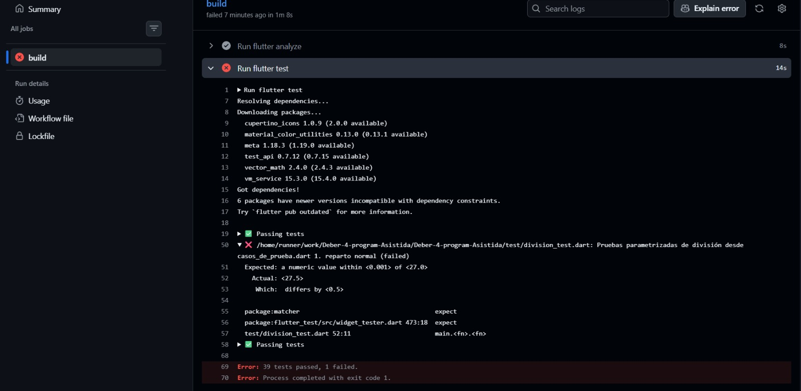

## Pregunta 1

name: CI

on:
  push:
    branches: [ main ]
  pull_request:

jobs:
  build:
    runs-on: ubuntu-latest

    steps:
      - uses: actions/checkout@v4

      - uses: subosito/flutter-action@v2
        with:
          channel: 'stable'

      - run: flutter pub get
      - run: flutter analyze
      - run: flutter test
      - run: flutter build apk --debug

  entrega:
    needs: build
    if: github.event_name == 'push' && github.ref == 'refs/heads/main'
    runs-on: ubuntu-latest

    steps:
      - uses: actions/checkout@v4

      - uses: subosito/flutter-action@v2
        with:
          channel: 'stable'

      - run: flutter pub get
      - run: flutter build apk --debug

      - uses: actions/upload-artifact@v4
        with:
          name: app-debug
          path: build/app/outputs/flutter-apk/app-debug.apk

Que hace el flutter analyze: Hace un análisis del código Dart que detecta los errores de sintaxis o si se rompe alguna regla de estilo de Flutter

Que hace el flutter test: Ejecuta las pruebas unitaria y de lógica que estén en la carpeta test/ para asegurarse de que los valores que se encuentran allí sean correctos

Que hace flutter build: compila el código generando el eejecutable nativo de android Lo que nos ayuda  a verificar que no hayan errores de empaquetado o de dependencias nativas

## Pregunta 2

Hubo un fallo en la línea 50 de test/casos_de_prueba.dart que nos muestra el valor esperado y el que realmente se puso.

X /home/runner/work/Deber-4-program-Asistida/Deber-4-program-Asistida/test/division_test.dart: Pruebas parametrizadas de division desde
casos_de_prueba.dart 1. reparto normal (failed)
Expected: a numeric value within <0.001> of <27.0>
Actual: <27.5>
Which: differs by <0.5>

## Pregunta 3

Diferencias:

Continuous Integration (CI) Automatiza la validación del código en cada uno de los commits o de las pull request para detectar errores

Continuous Delivery (CD): Asegura que el código que está en main siempre sea entregable y genera automáticamente el paquete para la distribución pero igual requiere un paso manual para publicarse

Continuous Deployment: Este hace todo 100% automatizado ya que cada cambio que se haga y pase las pruebas se publica sin intervención humana

En este proyecto usé CI para verificar cada PR con priebas y linter y CD cuando generé la apk del artifact descargable cuando se une al main

## Pregunta 4 

! 

Esto evita que el código defectuoso que tenga errores de cálculo o si no pasa las pruebas entre a la rama main lo que evita que si se está haciendo un proyecto entre varias personas estas descarguen código que no compila

## Pregunta 5 

El agente sugirió que usar channel: 'stable' es frágil ´prque si se actualiza flutter de forma inesperada se puede romper el linter. Recomendó fijar la versión exacta que se desea usar y agregar timeout-minutes: 15 para que los github actions no se queden ejecutando por tiempo indefinido y limitar los permisos con permissions: contents: read y evitar que se compile el APK dos veces

Yo aceptaría la de ponerle un límite de tiempo ya que esto evita que el pipeline se roompa solo o se gaste mucho tiempo si es que se congela.

Rechacé la de cambiar channel: 'stable' por una versión fija, ya que en la parte número 1 del deber dice que se use la versipon estable de Flutter y no agregue nada más 

## Pregunta 6

Que garantiza: que la sintaxis sea correcta, que el código compila y que se pasaron las pruebas automatizadas que se escribieron por mi

Que no detecta: No detecta errores cisuales de interfaz ni la lentitud en dispositivos reales ni los casos que no se hayan especificado en los test

Ejemplo de error que pasa en verde: Si se le pone texto al botón de cálculo y que el texto sea blanco mientras que el fonde del botón también. A su vez que el fondo de la aplicación también es blanco.

## Pregunta 7

El pipeline detectó que los jobs de GitHub Actions corren en entornos aislados ya que cuando se creó el job de entrega, este no tenía acceso al APK que el mismo job genera a menos que se corriera el job 2 veces o se transfiera por artifacts.