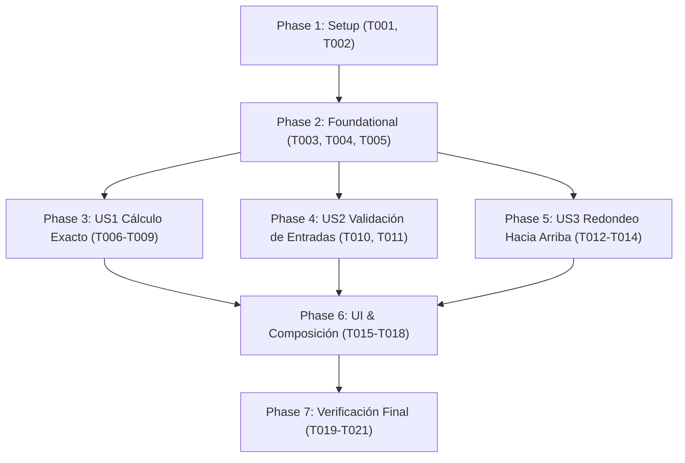

# Tasks: División de Cuenta de Restaurante

**Input**: Design documents from `specs/001-dividir-cuenta/`
**Prerequisites**: plan.md, spec.md, research.md, data-model.md, contracts/, quickstart.md

## Format: `- [ ] [TaskID] [P?] [Story] Description`
- **[P]**: Ejecución paralela (archivos independientes sin bloqueos)
- **[Story]**: Mapeo a historia de usuario ([US1], [US2], [US3])
- Rutas de archivo exactas en cada tarea

---

## Phase 1: Setup (Shared Infrastructure)

**Purpose**: Estructura de directorios y componentes transversales compartidos

- [x] T001 Crear estructura limpia de directorios en `lib/domain/entities/`, `lib/domain/usecases/`, `lib/domain/strategies/`, `lib/data/strategies/`, `lib/presentation/controllers/`, `lib/presentation/utils/`, `lib/presentation/views/`, `test/unit/domain/`, `test/unit/data/` y `test/widget/`
- [x] T002 [P] Implementar la utilidad `FormateadorMoneda` en `lib/presentation/utils/formateador_moneda.dart` para formateo a dos decimales exactos

---

## Phase 2: Foundational (Blocking Prerequisites)

**Purpose**: Modelos y abstracciones del dominio (Dart puro) necesarios para todas las historias

- [x] T003 [P] Crear la interfaz abstracta `EstrategiaRedondeo` en `lib/domain/strategies/estrategia_redondeo.dart` con el método `double redondear(double monto)` (Dart puro, sin imports de Flutter)
- [x] T004 [P] Crear la entidad inmutable `Cuenta` en `lib/domain/entities/cuenta.dart` con `montoBase`, `numeroPersonas`, `porcentajePropina` y `estrategiaRedondeo` (Dart puro)
- [x] T005 [P] Crear la entidad inmutable `Resultado` en `lib/domain/entities/resultado.dart` con `montoPorPersona`, `totalPropina` y `totalPagar` (Dart puro)

---

## Phase 3: User Story 1 - Cálculo de División Equitativa en Modo Exacto (Priority: P1) 🎯 MVP

**Goal**: Permitir calcular la división de la cuenta con propina en modo exacto (redondeo estándar a 2 decimales).
**Independent Test**: Escenario 1 (100.00, 4 personas, 10% -> 27.50), Escenario 2 (90.00, 3 personas, 0% -> 30.00) y Escenario 5 (10.00, 3 personas, 0% -> 3.33).

### Tests para User Story 1
- [x] T006 [P] [US1] Escribir pruebas unitarias para `RedondeoExacto` en `test/unit/data/redondeo_exacto_test.dart`
- [x] T007 [P] [US1] Escribir pruebas unitarias para `CalcularDivision` en `test/unit/domain/calcular_division_test.dart` verificando los escenarios 1, 2 y 5

### Implementación para User Story 1
- [x] T008 [P] [US1] Implementar `RedondeoExacto` en `lib/data/strategies/redondeo_exacto.dart` implementando `EstrategiaRedondeo` con fórmula `(monto * 100).round() / 100`
- [x] T009 [US1] Implementar el caso de uso `CalcularDivision` en `lib/domain/usecases/calcular_division.dart` que recibe `Cuenta` y retorna `Resultado` aplicando la estrategia inyectada (Dart puro)

---

## Phase 4: User Story 2 - Validación de Entradas y Manejo de Errores (Priority: P1)

**Goal**: Validar las entradas de usuario, emitiendo mensajes de error exactos ("Monto inválido", "Debe haber al menos una persona") y suprimiendo el cálculo ante datos erróneos.
**Independent Test**: Escenario 3 (50.00 con 0 personas -> "Debe haber al menos una persona" sin resultado) y Escenario 4 ("abc" -> "Monto inválido" sin resultado).

### Tests para User Story 2
- [x] T010 [P] [US2] Escribir pruebas unitarias para `ValidarEntrada` en `test/unit/domain/validar_entrada_test.dart` cubriendo los escenarios 3 y 4

### Implementación para User Story 2
- [x] T011 [US2] Implementar la clase `ValidarEntrada` en `lib/domain/usecases/validar_entrada.dart` con métodos `validarMonto` y `validarPersonas` retornando mensajes de error o `null` si son válidos (Dart puro)

---

## Phase 5: User Story 3 - Redondeo hacia Arriba al Entero más Cercano (Priority: P2)

**Goal**: Permitir seleccionar el modo hacia arriba elevando la cuota individual al entero superior.
**Independent Test**: Escenario 6 (10.00, 3 personas, 0% propina, modo hacia arriba -> 4.00).

### Tests para User Story 3
- [x] T012 [P] [US3] Escribir pruebas unitarias para `RedondeoHaciaArriba` en `test/unit/data/redondeo_hacia_arriba_test.dart`

### Implementación para User Story 3
- [x] T013 [P] [US3] Implementar `RedondeoHaciaArriba` en `lib/data/strategies/redondeo_hacia_arriba.dart` implementando `EstrategiaRedondeo` con fórmula `monto.ceilToDouble()`
- [x] T014 [US3] Integrar verificación del escenario 6 en `test/unit/domain/calcular_division_test.dart` usando `RedondeoHaciaArriba`

---

## Phase 6: UI, Presentación y Composición (Presentation Layer)

**Goal**: Conectar el dominio y los datos con la interfaz de usuario en Flutter mediante un controlador inyectado y `setState`.

- [x] T015 [US1] Implementar `DivisorController` en `lib/presentation/controllers/divisor_controller.dart` orquestando `ValidarEntrada`, `CalcularDivision` y la selección de estrategias
- [x] T016 [US1] Implementar la pantalla visual `PantallaDivisor` en `lib/presentation/views/pantalla_divisor.dart` utilizando `setState`, campos de texto numéricos, selector de redondeo, botón "Calcular" y presentación de resultado/error
- [x] T017 [US1] Configurar `lib/main.dart` como único punto de composición que instancia las clases concretas de `data/` y `domain/`, inyecta `DivisorController` y arranca la aplicación
- [x] T018 [P] [US1] Crear pruebas de widgets en `test/widget/pantalla_divisor_test.dart` que verifiquen de forma interactiva los 6 escenarios de aceptación completos

---

## Phase 7: Polish & Verification

**Purpose**: Asegurar la calidad estática, constitucional y de pruebas en todo el repositorio

- [x] T019 Ejecutar `flutter analyze` para certificar cero advertencias, cero errores de lint y null safety estricto
- [x] T020 Ejecutar `flutter test` verificando que el 100% de las pruebas unitarias y de widgets pasen exitosamente
- [x] T021 Verificar que ningún archivo bajo `lib/domain/` contenga `import 'package:flutter'` garantizando Dart puro

---

## Dependencies & Completion Order

## Parallel Execution Opportunities
- **Fase 2 (Foundational)**: T003, T004 y T005 pueden desarrollarse en paralelo al estar en archivos independientes.
- **Fases 3, 4 y 5**: US1 (T006-T009), US2 (T010-T011) y US3 (T012-T014) pueden desarrollarse en paralelo una vez completada la fase Foundational.
- **Pruebas unitarias**: T006, T007, T010 y T012 son paralelizables respecto a sus implementaciones.
